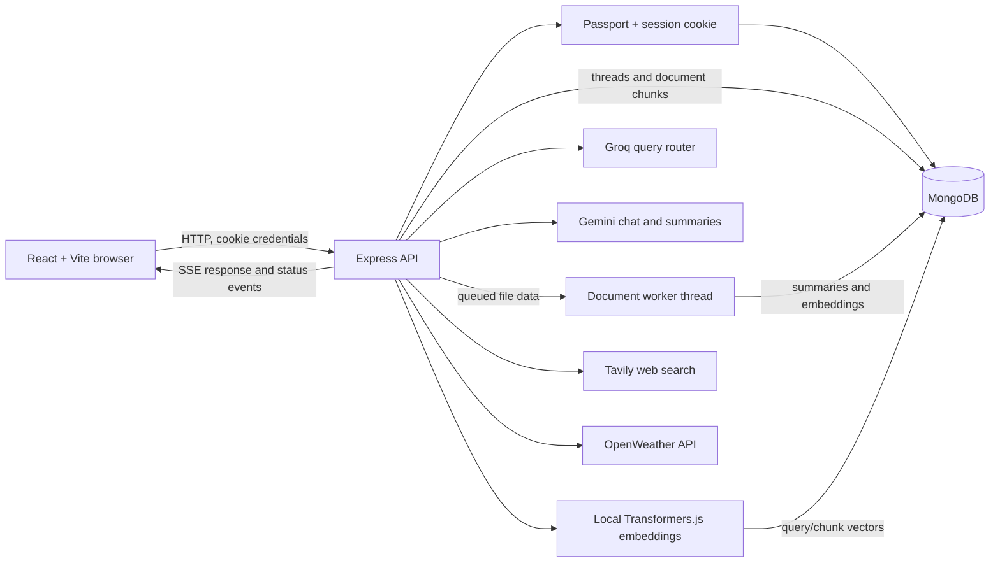

# NovaChat

NovaChat is a full-stack AI chat application with persistent conversations, account sessions, document question-answering, and optional live web and weather tools. It is built as a React/Vite frontend and an Express API backed by MongoDB.

This repository is an actively developed project, not a production-hardened service. The architecture and current limitations are documented below so users can understand what is implemented and what still needs work.

## Features

- **Streaming chat:** Gemini responses are streamed to the browser over Server-Sent Events (SSE).
- **Persistent conversations:** MongoDB stores user/assistant messages, thread titles, document metadata, and rolling conversation summaries.
- **Long-history handling:** Older messages are summarized in batches and combined with a recent message window for later requests.
- **Document Q&A:** Upload PDFs or text files to a thread. The backend extracts text, creates overlapping chunks, embeds them locally, and retrieves relevant passages for document questions.
- **Query-aware retrieval:** When a thread has documents, a structured router can skip retrieval, select documents, rewrite follow-up queries, or decompose multi-part questions. Decomposed retrieval uses Reciprocal Rank Fusion (RRF).
- **Live tools:** The model can call Tavily web search and OpenWeather current-weather tools. The chat UI displays tool and retrieval status while responses stream.
- **Authentication:** Passport local authentication and server-side Express sessions protect chat and document routes.
- **Markdown responses:** Assistant messages render Markdown, including highlighted code blocks.

## Architecture



### Chat request lifecycle

1. The browser sends a message and thread ID to `POST /api/chat` with the session cookie.
2. The API loads or creates the authenticated user's thread and saves the user message.
3. If the thread has documents, the router chooses direct answering or a retrieval strategy. Retrieved text is added to the model context; the model may also call web or weather tools.
4. The API sends text chunks and named status/citation events over SSE. The browser renders text as it arrives and displays status labels.
5. Once generation finishes, the assistant message is saved to MongoDB and the API sends a `done` event.

### Document ingestion and retrieval

1. The authenticated user uploads a file to a thread. The frontend offers PDF and TXT files. The API stores a pending document entry and immediately queues the upload in a Node.js worker thread.
2. The worker extracts PDF text with `pdf-parse`; text payloads are decoded as UTF-8. Gemini summarizes up to the first 8,000 characters for the thread's document catalog.
3. LangChain's `RecursiveCharacterTextSplitter` creates chunks of about 1,000 characters with 150 characters of overlap. Chunks of 50 characters or fewer are discarded.
4. Transformers.js runs `Xenova/all-MiniLM-L6-v2` in the worker thread to create normalized embeddings. Chunk text, vectors, owner, thread, and filename are stored in MongoDB. The frontend polls the document status endpoint and continues chat after processing is complete.
5. For document-related questions, the API embeds search queries locally and computes cosine similarity against that thread's ready document chunks. Multi-query results are fused with RRF.

The router supports `DIRECT`, `RAG_SINGLE`, `RAG_REWRITE`, and `RAG_DECOMPOSE` decisions. Single-query retrieval returns up to three chunks above a 0.38 similarity threshold. Multi-query retrieval searches up to four chunks per sub-query (using a 0.35 threshold), fuses rankings, and returns up to four chunks.

## Technology Choices and Tradeoffs

| Choice | Why it fits this project | Tradeoff |
| --- | --- | --- |
| React and Vite | Fast, component-based chat UI with a simple development/build workflow. | The frontend and backend are separate npm projects, so dependencies and commands are managed separately. |
| Express and MongoDB/Mongoose | Keeps the API and persistence model straightforward for a small chat application; sessions, threads, and chunks fit the existing stack. | Thread messages are embedded in a MongoDB document and can grow over time. Chunk retrieval currently loads matching thread chunks and scores them in Node, which scales linearly rather than using a vector index. |
| Passport local auth and cookie sessions | Familiar server-side authentication with owner-scoped data queries. | The current default session store is Express MemoryStore, which is unsuitable for production and does not share sessions across multiple server instances. |
| Gemini for chat and document summaries | Provides the main generation path and supports tool calling through the LangChain integration. | Requests incur provider cost/limits and transmit prompts to the provider. Retrieved document passages and document-summary input are not kept exclusively local. |
| Local Transformers.js embeddings | Avoids a hosted embedding API and keeps full-document embedding computation on the application host. | The model must be downloaded and loaded locally; first use is slower and inference consumes server memory/CPU. This does not make the overall RAG flow private because Gemini receives selected context. |
| MongoDB-stored vectors with in-process cosine similarity | Easy to inspect and sufficient for a small prototype without operating another vector service. | There is no approximate-nearest-neighbor index; retrieval work and memory use grow with the number of chunks in a thread. |
| SSE for generation | Delivers incremental text and status updates over a single request, with no separate WebSocket service. | The client must parse the stream, and proxy buffering/timeouts need attention when deploying behind a reverse proxy. |
| Groq router and external tools | Structured routing can avoid unnecessary retrieval; Tavily and OpenWeather provide live information beyond the uploaded documents. | These features depend on external services and API keys. Tool output and routing decisions can fail independently of the main chat model. |

## Requirements

- Node.js 20.19+ or 22.12+ and npm (required by the current Vite version).
- MongoDB, local or hosted.
- Gemini API key for chat responses and document summaries.
- Groq API key for the intended query-router and conversation-summary path. Without it, the current router falls back to document retrieval when routing fails, and conversation summarization may be skipped.
- Optional Tavily and OpenWeather API keys for web search and weather tools.

The first local embedding request downloads and initializes the Transformers.js model, so it can take longer than later requests.

## Configuration

Create `Backend/.env`:

```env
LOCAL_MONGODB_URI=mongodb://127.0.0.1:27017/novachat
SESSION_SECRET=replace_with_a_long_random_secret
GEMINI_API_KEY=your_gemini_api_key
GROQ_API_KEY=your_groq_api_key
TAVILY_API_KEY=your_tavily_api_key
OPENWEATHER_API_KEY=your_openweather_api_key
```

Only Gemini and MongoDB are needed for the basic chat and persistence path. Groq enables the intended structured routing/summarization path; Tavily and OpenWeather are optional. Do not commit `.env` files or real credentials. Set a unique, strong `SESSION_SECRET` outside development; the current server has an insecure development fallback.

The frontend defaults to `http://localhost:8080`. Set `VITE_API_URL` in `Frontend/.env` to change the API origin. The backend currently allows CORS from `http://localhost:5173`; update the server configuration to match any deployed frontend origin.

## Installation and Local Development

Install dependencies in each project:

```bash
cd Backend
npm install

cd ../Frontend
npm install
```

Start MongoDB, configure `Backend/.env`, then run the API in one terminal:

```bash
cd Backend
npm run dev
```

The API listens on `http://localhost:8080`. Start the frontend in another terminal:

```bash
cd Frontend
npm run dev
```

Vite serves the app at `http://localhost:5173`.

Available frontend checks:

```bash
cd Frontend
npm run lint
npm run build
```

There is no automated backend test script configured yet. `Backend/test.js` is a standalone NVIDIA API connectivity check and requires `NVIDIA_API_KEY`; it is not an application test suite.

## RAG Evaluation

The repository includes a 40-query evaluation dataset and a runner that compares basic cosine retrieval against the router-based RAG pipeline. Run it from the backend directory:

```bash
cd Backend
node scripts/runEvals.js
```

The runner requires `LOCAL_MONGODB_URI` and a model API key for routing and answer generation. It seeds a dedicated evaluation thread and replaces its existing chunks each run. Set `EVAL_SKIP_GENERATION=1` to skip answer generation; routing and retrieval still run, so this does not eliminate model API usage. Results are written to `Backend/evals/results.json` and the summary report to `EVAL.md`.

Metrics are checks against the dataset's expected routes and retrieval keywords, not independent proof that every generated answer is correct:

- **Router accuracy** compares the route selected by the model with the dataset's `expectedRoute`.
- **Hit-Rate@3** checks whether retrieved top-three chunks contain the expected keywords. Multi-document questions require all keywords across the top three.
- **MRR@3** rewards relevant chunks appearing nearer the top; misses score zero.
- **Retrieval suppression and refusal rate** measure whether unanswerable questions return no chunks and whether generated answers match a refusal-phrase pattern. Phrase matching is approximate.
- **Retrieval latency and TTFT** are timings from that run and machine. TTFT includes retrieval plus generation time to the first token.

For correctness, inspect the per-query routes, scores, and generated answers in `Backend/evals/results.json`; compare answers with the source files in `Backend/evals/test_docs/`; and review whether the expected routes and keywords in `Backend/evals/dataset.json` are appropriate. The result file does not include the retrieved chunk text, so reproduce retrieval or inspect the source documents when investigating a retrieval miss. The report is useful for comparing changes under the same setup, but its scores depend on this small hand-authored dataset and are not a substitute for manual review.

## API

Authentication endpoints are mounted under `/auth`. Chat routes are mounted under `/api`; document routes are mounted under `/document`. Protected endpoints require the session cookie established by login or signup.

### Authentication

| Method | Endpoint | Description |
| --- | --- | --- |
| `POST` | `/auth/signup` | Create an account and log in. Expects `username`, `email`, and `password`. |
| `POST` | `/auth/login` | Authenticate and establish a session. |
| `GET` | `/auth/session` | Return the current user or `401` if unauthenticated. |
| `GET` | `/auth/logout` | End the current Passport session. |

### Threads and chat

All endpoints below require authentication.

| Method | Endpoint | Description |
| --- | --- | --- |
| `GET` | `/api/thread` | List the current user's threads, newest updated first. |
| `GET` | `/api/thread/:threadId` | Get messages from an owned thread. |
| `POST` | `/api/chat` | Save a message, generate a response, and stream it over SSE. |
| `DELETE` | `/api/thread/:threadId` | Delete an owned thread and its associated document chunks. |

Chat request body:

```json
{
  "threadId": "client-generated-thread-id",
  "message": "Summarize the main findings in my report"
}
```

The response is `text/event-stream`, not a JSON reply. Unnamed events carry JSON data such as `{ "content": "..." }`. Named events include `status`, `citations`, `done`, and `error`. The backend emits structured citation metadata, but the current frontend does not yet render citation events as clickable source references.

### Documents

| Method | Endpoint | Description |
| --- | --- | --- |
| `POST` | `/document/upload` | Multipart upload with fields `file` and `threadId`; extracts, summarizes, chunks, embeds, and stores the document. |

The upload endpoint requires an authenticated user and a thread owned by that user (or creates the thread for the supplied ID). The frontend file picker advertises `.pdf` and `.txt` files.

## Security and Deployment Status

This project should not be exposed to untrusted users as-is. Before deployment, address at least the following:

- Replace the default in-memory session store with a persistent store, use a strong secret, configure secure cookies for HTTPS, and set Express proxy handling correctly when behind a reverse proxy.
- Restrict CORS to the deployed frontend origin and configure the frontend API URL for the deployment.
- Add request validation, authentication rate limits, upload size limits, and server-side file-type/content validation. Multer currently uses in-memory storage without explicit limits or an allowlist.
- Review privacy and retention requirements. Extracted text, summaries, and retrieved passages may be sent to Gemini; web queries are sent to Tavily and weather queries to OpenWeather.
- Configure reverse-proxy buffering/timeouts for SSE and add graceful handling for database/model-provider outages.

Thread and document chunk queries are scoped to the authenticated owner; chunk retrieval is additionally scoped to the current thread. This is useful application-level isolation, but it does not replace deployment hardening or a security review.

## Known Limitations and Roadmap

- Vector search scans the thread's stored chunks in application code; a vector index or dedicated vector database may be appropriate as document volume grows.
- PDF extraction is text-based; scanned documents need OCR. Upload validation and limits are not yet enforced server-side.
- Citation metadata is emitted by the backend but is not yet presented as an inspectable source UI. The model's prose citations are not independently validated.
- Session storage, rate limiting, input validation, production CORS/cookie configuration, and automated backend tests need hardening before a public deployment.
- The planned work is tracked in [`plan/upgrade.md`](plan/upgrade.md). It includes production hardening, tests and containerization, further retrieval evaluation, citation UX, observability, and deployment work. Those items are plans, not claims about current functionality.

## Project Structure

```text
NovaChat/
├── Backend/
│   ├── controllers/       # Chat, document ingestion, and authentication flows
│   ├── models/            # User, thread, and document-chunk schemas
│   ├── routes/            # Authenticated API route definitions
│   ├── utils/             # Model adapters, query router, RAG, and tools
│   ├── middlewares.js     # Authentication middleware
│   ├── package.json
│   └── server.js          # Express, Passport/session, CORS, and MongoDB setup
├── Frontend/
│   ├── src/components/    # Chat, chat window, and sidebar
│   ├── src/context/       # Shared chat and user state
│   ├── src/pages/         # Landing, authentication, and chat pages
│   ├── package.json
│   └── vite.config.js
├── plan/upgrade.md        # Planned improvements and roadmap
└── README.md
```